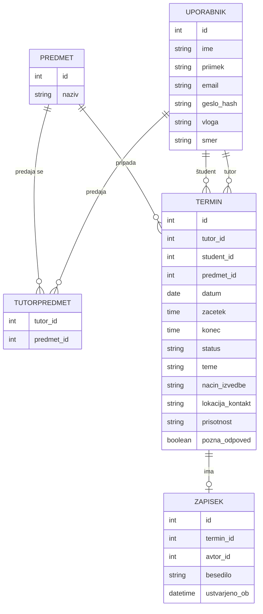

# SuperTutor

Podatkovni model je zasnovan za relacijsko podatkovno bazo (SQLite za lokalni razvoj). Rešitev ima pet glavnih entitet: Uporabnik, Predmet, TutorPredmet, Termin in Zapisek.

## Entitete

- **Uporabnik**: predstavlja študenta, tutorja ali koordinatorja. Vloga določa, kaj uporabnik v sistemu lahko počne. Vsebuje tudi podatek o smeri študija, ki se uporablja za prikaz relevantnih predmetov in tutorjev.
- **Predmet**: predmet, pri katerem tutorji nudijo pomoč.
- **TutorPredmet**: povezovalna entiteta, ki določa, katere predmete posamezen tutor predaja.
- **Termin**: osrednja entiteta rešitve. Nastane, ko tutor označi prosti termin, in se dopolni, ko študent pošlje zahtevo (predmet, teme, način izvedbe). Vsebuje tudi podatke o prisotnosti študenta in o morebitni pozni odpovedi.
- **Zapisek**: zapisek, ki ga tutor napiše po srečanju, o tem, kako se študent najbolje uči.

## Povezave med entitetami

- En **uporabnik** (tutor) lahko predaja več **predmetov**, en **predmet** lahko predajajo več tutorjev (povezava prek TutorPredmet).
- En **uporabnik** (tutor) ima lahko več **terminov**.
- En **uporabnik** (študent) ima lahko več **terminov**.
- En **predmet** je lahko povezan z več **termini**.
- En **termin** ima največ en **zapisek**.

## Osnutek podatkovnega modela

