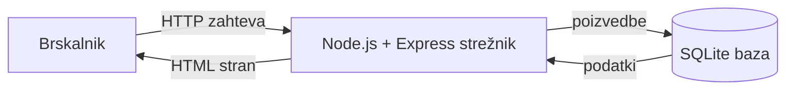

# SuperTutor

## Arhitektura

### Glavni deli sistema
- **Brskalnik**: prikaže strani, ki jih pripravi strežnik - HTML, CSS in malo JavaScripta.
- **Strežnik (Node.js + Express)**: tu bo tekla vsa logika - prijava, preverjanje, ali je termin še prost, preverjanje roka za odpoved, preverjanje e-pošte ob registraciji. Strežnik bo tudi sestavil strani in jih poslal nazaj brskalniku.
- **Podatkovna baza (SQLite)**: hranila bo uporabnike, predmete, termine in zapiske.

### Komunikacija med deli sistema
Ko bo uporabnik nekaj naredil (npr. poslal zahtevo za termin), bo brskalnik poslal zahtevo strežniku. Ta bo po potrebi bral ali pisal v bazo, sestavil stran in jo poslal nazaj. Vsa logika se bo torej dogajala na strežniku.

### Podatkovna baza
SQLite - cela baza bo ena datoteka znotraj projekta, kar je za lokalni razvoj najpreprostejše.

### Avtentikacija oziroma upravljanje uporabnikov
Študent se bo registriral sam, z obveznim fakultetnim e-poštnim naslovom (`@student.um.si`). Ob registraciji bo izbral tudi svoj smer študija s seznama. Geslo bo shranjeno zgoščeno, ne v čistem besedilu.

Tutorje bo dodajal koordinator, ker mora biti tutor dejanski študent, ki tutorstvo opravlja - sam se torej ne bo mogel registrirati kot tutor. Koordinatorjev račun bo narejen ročno.

Po prijavi si bo strežnik zapomnil, kdo je prijavljen, prek seje. V bazi bo shranjena tudi vloga uporabnika, ki bo določala, kaj lahko vidi in počne.

### Način lokalnega zagona
1. Namestimo Node.js.
2. Kloniramo projekt in poženemo namestitev odvisnosti.
3. Poženemo strežnik, ki se zažene na `http://localhost:3000`.
4. Baza se ob prvem zagonu sama ustvari.

### Namestitev (deployment)
Za zdaj aplikacija ni javno dostopna na internetu, deluje samo lokalno (glej "Način lokalnega zagona"). Ko bo prišel čas za javno namestitev, je SQLite dovolj enostaven, da projekt brez večjih sprememb deluje tudi na enem samem oddaljenem strežniku (npr. Render ali Railway) - baza je ena datoteka, ki potuje skupaj s kodo. Če bi aplikacija kasneje rasla in bi jo uporabljalo več ljudi hkrati, bi bil smiseln prehod na PostgreSQL, saj ta bolje prenese več hkratnih uporabnikov, ki berejo in pišejo v bazo.

### Diagram arhitekture

## Tehnološki sklad

| Del aplikacije | Tehnologija |
|---|---|
| Frontend | HTML, CSS, JavaScript |
| Backend | Node.js, Express |
| Podatkovna baza | SQLite |
| Avtentikacija | seje, bcrypt za gesla |
| Lokalni razvoj | npm |

## Arhitekturne odločitve

Backend bomo delali v Node.js z Express, ker JavaScript že poznamo s frontenda - tako nam ne bo treba poleg vsega drugega učiti še novega jezika.

Strani se bodo generirale kar na strežniku, brez ločenega API-ja in React-a ali podobnega.

Za bazo bomo vzeli SQLite, ker je samo ena datoteka in jo lahko kar takoj uporabimo, brez da bi morali karkoli posebej nameščati. To je pomembno predvsem zdaj, v fazi razvoja - ni treba skrbeti za ločen strežnik baze, nastavitve ali gesla zanj, kar razvoj in testiranje naredi precej hitrejše in enostavnejše.

Prijava bo delovala prek sej, za spletno stran brez mobilne aplikacije bo to dovolj.

Gesla ne bodo shranjena kot besedilo, ampak zgoščena (bcrypt).

Smeri študija bodo zaenkrat samo seznam v kodi, ne posebna tabela - ni jih veliko in se ne spreminjajo pogosto.

Za zdaj namestitve na internet ne načrtujemo - aplikacija bo delovala lokalno, kar je za fazo razvoja dovolj. Ko bo prišel čas za to, izbrana tehnologija (SQLite) omogoča preprost prehod na javno namestitev brez večjih sprememb kode.