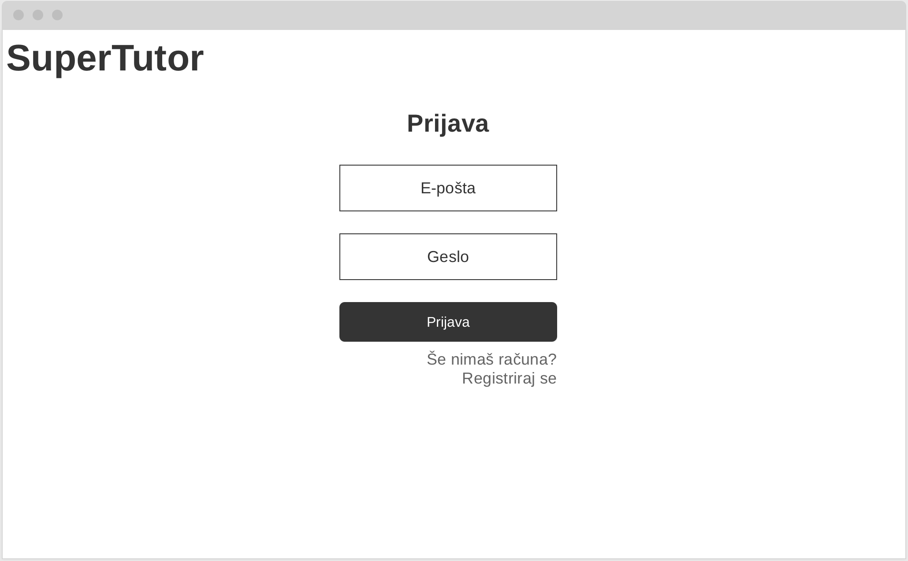
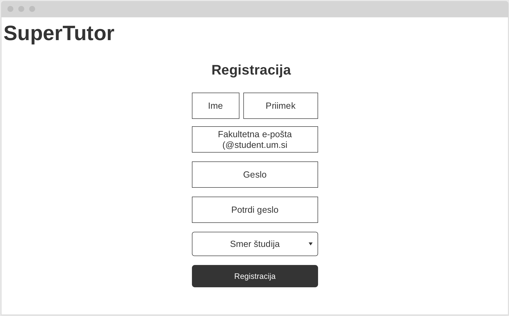
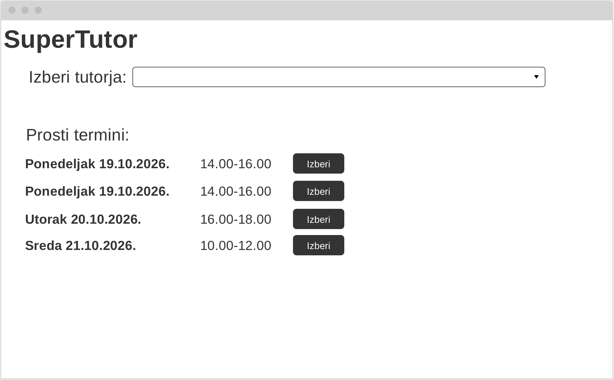
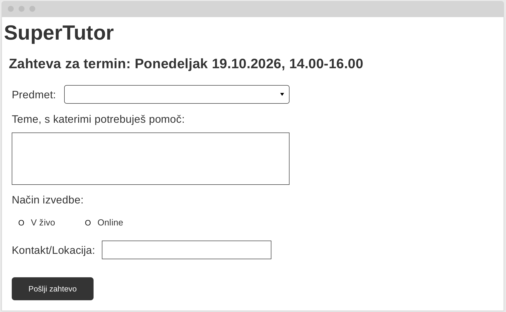
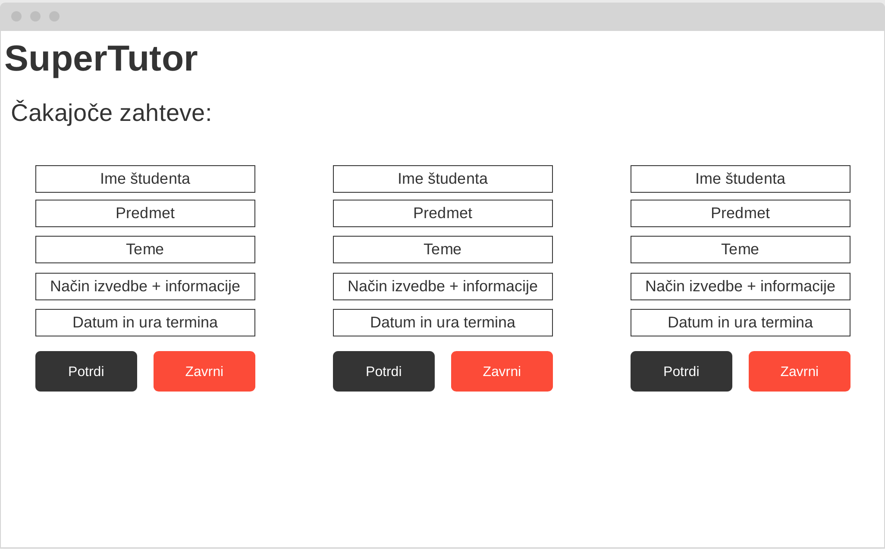
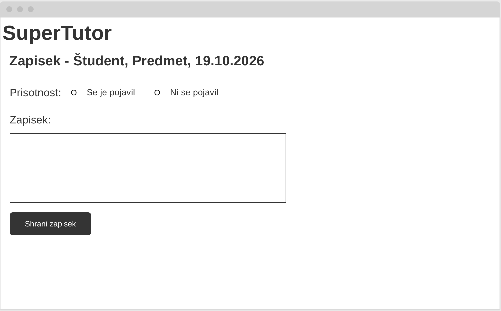

# Wireframes

## 1. Prijava

Uporabnik vnese e-pošto in geslo ter se prijavi v sistem. Na voljo je tudi povezava za registracijo, če računa še nima.

## 2. Registracija

Študent vnese ime, priimek, fakultetno e-pošto, geslo (dvakrat, za potrditev) in izbere svoj smer študija s seznama.

## 3. Pregled prostih terminov

Študent izbere tutorja in vidi seznam njegovih prostih terminov. Izbere enega, kar ga vodi na naslednji zaslon.

## 4. Oddaja zahteve

Študent za izbrani termin izbere predmet, vpiše teme, s katerimi potrebuje pomoč, in izbere način izvedbe (v živo ali online), nato pošlje zahtevo.

## 5. Čakajoče zahteve

Tutor vidi seznam prejetih zahtev s predmetom, temami in načinom izvedbe ter jih lahko potrdi ali zavrne.

## 6. Zapisek po srečanju

Tutor po srečanju označi, ali se je študent pojavil, in napiše zapisek o tem, kako se študent najbolje uči, kaj mu pomaga in na čem je treba delati naslednjič.